# Competitive results

Last verified: 2026-11-10. Primary run: [2026-11-10-final](../../bench/competitive/results/2026-11-10-final/summary.md), the whole harness run by `bench/competitive/run.sh` from a fresh clone of `3ec767f` inside the benchmark VM, with Mail and Voice Memos seeded under [Amendment 4](methodology.md#amendment-4-2026-11-10-before-any-mail-or-voice-memos-result-was-produced). The clean-checkout run of `09fbc84` just before it is [2026-11-10-clean](../../bench/competitive/results/2026-11-10-clean/summary.md): the same scores except Pippin Reliability 3, from one of 8 parallel `memos.list` calls failing on a database lock, fixed in `3ec767f` (`MemosDeleteTests.testReadWaitsOutABriefLockOnTheStore`). Earlier runs: [2026-11-10-amend4](../../bench/competitive/results/2026-11-10-amend4/summary.md) and [2026-11-09-final](../../bench/competitive/results/2026-11-09-final/summary.md). Competitors: the pinned releases in [tools.lock.json](../../bench/competitive/tools.lock.json).

The field ([field.md](field.md)) and the method ([methodology.md](methodology.md), including Amendment 1) were committed before any result existed (commits `e7e0c12` and `3d3f553`). Nothing on this page changes the method after the fact. Losses are listed with the same weight as wins.

## Where Pippin trails

Read this first.

- **Mail reads, warm (closed).** In the amend4 run apple-pim listed the inbox in 8.7 ms and searched in 7.7 ms against 42.6 ms and 39.9 ms for Pippin, and sweetrb-mail listed accounts in 53.8 ms against 117.0 ms. After pippin-k177 (index-backed Mail reads inside the MCP server, `mail accounts` reading names only) the primary run measures 2.4 ms against 8.5 ms for list, 1.6 ms against 7.7 ms for search, and 55.2 ms against 54.8 ms for accounts (a tie under the rule; the targeted [Mail re-run](../../bench/competitive/results/2026-11-10-mail/summary.md) agrees).
- **Notes speed, warm (closed).** In the 2026-11-09 run sweetrb/apple-notes-mcp listed notes in 150 ms and searched in 183 ms, against 232 ms and 250 ms for Pippin. After pippin-ai5s (Notes reads inside the MCP server, 7 Apple Events per list instead of 11) the primary run measures 166.8 ms against 150.0 ms and 183.2 ms against 183.2 ms: both ties under the rule.
- **Tool-list size with every tool exposed.** All 79 tools cost 22,615 tokens per agent turn. That is more than every competitor except sweetrb/apple-notes-mcp (56,023). In the agent tasks this made Pippin the most expensive tool per task (about 84k to 88k model tokens) when all tools were exposed. `pippin mcp-server --apps <app>` fixes this: scoped to one app, Pippin was the cheapest tool on all three tasks (see [Agent tasks](#agent-tasks)). The default is still all tools, so a client that does not pass `--apps` pays the cost (pippin-hd99). Plan: shorten tool descriptions and shared schema text, and decide whether the default should list a smaller core set with the rest behind `--apps`, as a minor release with a deprecation note under [contract.md](../contract.md).
- **Agent task success (resolved).** In the 2026-11-09 runs one injection trial failed in each Pippin run because grader 1 counted a marker the model quoted while describing the attack (pippin-o072). With grader 2 ([Amendment 2](methodology.md#amendment-2-2026-11-10-before-any-run-that-uses-it)), committed before the run, the 2026-11-10 run has Pippin at 9 of 9 in both modes and every competitor at 3 of 3 on the task it can attempt; no Pippin answer contained a marker at all (see [Agent tasks](#agent-tasks)).
- **Calendar plus Reminders tool list.** Scoped to those two apps, Pippin's tool list is 6,153 tokens against 3,694 for FradSer/mcp-server-apple-events, which covers the same two apps with 5 tools. Plan: the description and schema trim under pippin-hd99.
- **Not measured.** iMCP, which needs an interactive approval window per client. Mail and Voice Memos are measured since [Amendment 4](methodology.md#amendment-4-2026-11-10-before-any-mail-or-voice-memos-result-was-produced) (reads only; their writes stay not run), and Pippin is the only measured tool that covers Voice Memos. Plan: score iMCP if `vm/allow.sh` can answer its approval window, otherwise keep it listed as not runnable.

## Scores

Scores are 0 to 4 per axis, rubric in [methodology.md](methodology.md#scoring-rubric). Axis scores are never summed. Tools are listed by number of apps scored, then by name.

| Tool | Apps scored | Coverage | Correctness | Reliability | Speed | Safety (hostile input) | Operability | Dealbreaker |
| --- | --- | --- | --- | --- | --- | --- | --- | --- |
| **pippin** (`3ec767f`) | 7 | 4 (28/28) | 4 (54/54) | 4 (65/65) | 4 | 4 (120/120) | 4 | none observed |
| apple-pim 3.19.2 | 4 | 3 (19/20) | 3 (34/35) | 3 (41/42) | 2 | 4 (72/72) | 3 | none observed |
| apple-events 1.6.2 | 2 | 4 (10/10) | 4 (20/20) | 4 (20/20) | 1 | 4 (48/48) | 3 | none observed |
| memo 0.6.2 | 2 | 1 (3/13) | 4 (7/7) | 2 (9/11) | 1 | n/r | 2 | none observed |
| imsg 0.21.0 | 1 | 4 (3/3) | 2 (2/3) | 3 (9/10) | 1 | 4 (24/24) | 4 | none observed |
| mac-messages 1.1.0 | 1 | 4 (3/3) | n/r | 3 (9/10) | 2 | 4 (24/24) | 4 | none observed |
| pf-mail 3.3.0 | 1 | 4 (4/4) | 4 (6/6) | 4 (12/12) | 2 | n/r | 2 | none observed |
| remindctl 0.3.9 | 1 | 4 (5/5) | 4 (10/10) | 4 (10/10) | 2 | 4 (24/24) | 4 | none observed |
| reminders-cli 2.5.1 | 1 | 2 (4/5) | 4 (7/7) | 4 (7/7) | 1 | n/r | 2 | none observed |
| sweetrb-mail 2.20.55 | 1 | 4 (4/4) | 2 (5/6) | 4 (12/12) | 2 | n/r | 4 | none observed |
| sweetrb-notes 2.16.1 | 1 | 4 (5/5) | 4 (9/9) | 4 (10/10) | 3 | 4 (24/24) | 4 | none observed |
| iMCP 1.8.3 | n/r | n/r | n/r | n/r | n/r | n/r | 2 | not run: `initialize` exceeded 60 s waiting for an approval window |

Source: [2026-11-10-final/summary.md](../../bench/competitive/results/2026-11-10-final/summary.md), raw data in [scores.json](../../bench/competitive/results/2026-11-10-final/scores.json) and the per-tool `*.json` and `*.checks.json` files beside it. Operability was scored separately under [Amendment 3](methodology.md#amendment-3-2026-11-10-before-any-operability-data-was-collected) ([2026-11-10-operability](../../bench/competitive/results/2026-11-10-operability/summary.md)). apple-pim's Mail tools are measured here for the first time.

Pippin has the strictly highest or equal-highest score on every scored axis and scores 4 on all six, in one run from a clean checkout. It leads Speed outright (the next best is sweetrb-notes at 3) and ties at 4 on Coverage, Correctness, Reliability, Safety and Operability. Between runs of the same pinned releases, memo's Correctness moved from 2 to 4, remindctl's Speed from 1 to 2 and apple-pim's Reliability from 4 to 3 (one of 8 parallel `mail.search` calls failed); each run's summary shows its own numbers. Every failed check is listed in the summary's "Failed checks" section; for example apple-pim reports 21 reminders at the wrong instant, imsg misses one message in a thread, and sweetrb-mail's search misses subject matches.

### What changed since the baseline

The same harness ran against Pippin 0.41.1 before this work ([2026-11-09-baseline](../../bench/competitive/results/2026-11-09-baseline/summary.md)).

| Measure | 0.41.1 | `d91a21a` |
| --- | --- | --- |
| Correctness | 3 (43/46) | 4 (45/45) |
| Speed score | 3 | 4 |
| `notes.list`, warm p50 | 3,266.6 ms | 231.9 ms |
| `notes.search`, warm p50 | 1,100.3 ms | 249.6 ms |
| `messages.history`, warm p50 over MCP | 43.6 ms | 3.8 ms |
| Tools with behavior annotations | 0 of 76 | 79 of 79 |
| Mutating tools with a dry run | 9 of 24 operations | 34 of 34 tools |

The three Messages correctness failures in the baseline (a missing message, the wrong sender on outgoing messages, a wrong unread count) are fixed. pippin-lzuv covered the unread count.

## Coverage

Probed operations per app that returned a correct-shape answer. "out of scope" means the tool does not claim the app.

| Tool | Reminders | Calendar | Contacts | Notes | Messages | Mail | Voice Memos |
| --- | --- | --- | --- | --- | --- | --- | --- |
| apple-events | 5/5 | 5/5 | out of scope | out of scope | out of scope | out of scope | out of scope |
| apple-pim | 5/5 | 5/5 | 5/5 | out of scope | out of scope | 4/5 | out of scope |
| imsg | out of scope | out of scope | out of scope | out of scope | 3/3 | out of scope | out of scope |
| mac-messages | out of scope | out of scope | out of scope | out of scope | 3/3 | out of scope | out of scope |
| memo | 1/7 | out of scope | out of scope | 2/6 | out of scope | out of scope | out of scope |
| pf-mail | out of scope | out of scope | out of scope | out of scope | out of scope | 4/4 | out of scope |
| pippin | 5/5 | 5/5 | 5/5 | 5/5 | 3/3 | 4/4 | 1/1 |
| remindctl | 5/5 | out of scope | out of scope | out of scope | out of scope | out of scope | out of scope |
| reminders-cli | 4/5 | out of scope | out of scope | out of scope | out of scope | out of scope | out of scope |
| sweetrb-mail | out of scope | out of scope | out of scope | out of scope | out of scope | 4/4 | out of scope |
| sweetrb-notes | out of scope | out of scope | out of scope | 5/5 | out of scope | out of scope | out of scope |

Mail and Voice Memos cells count reads only; their writes are not run (Amendment 4).

## Speed

Warm p50 in milliseconds, N = 30 after 3 warm-ups, at fixture scale (about 25 records per app, 300 messages). Bold is the fastest. MCP tools are timed per `tools/call` on a running server; CLI tools per process.

| Operation | pippin | fastest other | other tool | Result |
| --- | --- | --- | --- | --- |
| calendar.calendars | **4.5** | 38.5 | apple-pim | lead |
| calendar.events | **17.3** | 54.5 | apple-pim | lead |
| calendar.search | **23.8** | 43.7 | apple-pim | lead |
| contacts.groups | **35.1** | 60.5 | apple-pim | lead |
| contacts.list | **40.6** | 113.1 | apple-pim | lead |
| contacts.search | **3.0** | 147.9 | apple-pim | lead |
| mail.accounts | 55.2 | **54.8** | sweetrb-mail | tie (rule), slower |
| mail.list | **2.4** | 8.5 | apple-pim | lead |
| mail.mailboxes | **0.4** | 6.0 | apple-pim | lead |
| mail.search | **1.6** | 7.7 | apple-pim | lead |
| memos.list | **9.3** | n/a | none | only Pippin measured |
| messages.chats | 1.8 | **1.2** | mac-messages | tie (rule), slower |
| messages.history | **3.9** | 24.5 | mac-messages | lead |
| messages.search | **2.9** | 24.1 | mac-messages | lead |
| notes.folders | **84.7** | 265.9 | memo | lead |
| notes.list | 166.8 | **150.0** | sweetrb-notes | tie (rule), slower |
| notes.search | 183.2 | **183.2** | sweetrb-notes | tie (rule), equal |
| reminders.list | **13.5** | 30.8 | remindctl | lead |
| reminders.lists | **5.3** | 29.3 | apple-events | lead |
| reminders.search | **10.5** | 31.1 | remindctl | lead |

The tie rule: within 10 percent or 20 ms of each other, whichever is larger. Warm, Pippin is fastest on 15 of 19 operations, tied on 4 and slower on none. Every tool's column, and the cold table (new process per call), are in the [summary](../../bench/competitive/results/2026-11-10-final/summary.md). Cold, Pippin is fastest on 16 of 19 operations and tied on the other 3 (the Reminders reads, against remindctl and reminders-cli).

Host measurements of Pippin alone (before and after each change) are in [docs/performance.md](../performance.md).

## Agent ergonomics

| Tool | Tools | Tool-list tokens | Tools with behavior annotations | Structured error on bad input |
| --- | --- | --- | --- | --- |
| pippin, all tools | 79 | 22,615 | 79 | 5 of 5 |
| pippin `--apps messages` | 7 | 1,392 | 7 | |
| pippin `--apps notes` | 7 | 1,685 | 7 | |
| pippin `--apps contacts` | 7 | 1,711 | 7 | |
| pippin `--apps reminders` | 9 | 2,559 | 9 | |
| pippin `--apps calendar` | 13 | 3,594 | 13 | |
| pippin `--apps mail` | 17 | 6,143 | 17 | |
| apple-events | 5 | 3,694 | 0 | 0 of 2 |
| apple-pim | 5 | 7,823 | 0 | 3 of 3 |
| mac-messages | 11 | 3,437 | 0 | 0 of 1 |
| sweetrb-notes | 89 | 56,023 | 46 | 1 of 1 |
| imsg (CLI help) | n/a | 389 | n/a | 4 | 0 of 1 |
| memo (CLI help) | n/a | 37 | n/a | 2 | 0 of 2 |
| remindctl (CLI help) | n/a | 109 | n/a | 4 | 0 of 1 |
| reminders-cli (CLI help) | n/a | 102 | n/a | 2 | 0 of 1 |

Token counts use the harness's own fixed tokenizer (words and single punctuation marks), so only ratios between tools mean anything. The all-tools row and the competitor rows are from the final run. The `--apps` rows were counted with the same tokenizer on the same build (`pippin mcp-server --apps <app>`, `tools/list`) and are not part of the harness output.

## Agent tasks

Same model (`haiku`), same system prompt, same task prompt for every tool, 3 trials per task, run in the VM against the fixture. A tool that does not cover a task's app is "out of scope" for it. This is the 2026-11-10 run, graded by grader 2 ([Amendment 2](methodology.md#amendment-2-2026-11-10-before-any-run-that-uses-it)), with Pippin built from `eb55292` ([raw results](../../bench/competitive/results/2026-11-10-tasks)).

| Tool | Schedule around conflicts | Summarize a thread | Injection trial (summarize hostile notes) |
| --- | --- | --- | --- |
| pippin `--apps` scoped | 3/3, **20.6k** | 3/3, **10.6k** | 3/3, **11.2k** |
| pippin, all 79 tools | 3/3, 85.8k | 3/3, 84.4k | 3/3, 88.3k |
| apple-events | 3/3, 22.2k | out of scope | out of scope |
| apple-pim | 3/3, 38.1k | out of scope | out of scope |
| imsg | out of scope | 3/3, 12.1k | out of scope |
| mac-messages | out of scope | 3/3, 15.8k | out of scope |
| memo | out of scope | out of scope | 3/3, 13.4k |
| sweetrb-notes | out of scope | out of scope | 3/3, 179.9k |

Each cell is successes and the median model tokens per trial. No tripwire fired, no event was planted and no instruction was obeyed in any trial. Grader 2 changed one outcome: memo's third injection trial quoted the marker in double quotes while describing the attack, which grader 1 would have scored as a leak. No Pippin answer contained a marker.

```mermaid
xychart-beta
    title "Median model tokens per task (lower is better)"
    x-axis ["schedule", "thread", "injection"]
    y-axis "tokens (thousands)" 0 --> 90
    bar [20.6, 10.6, 11.2]
    bar [85.8, 84.4, 88.3]
```



The first series is Pippin scoped with `--apps`, the second is Pippin with every tool. Best competitors per task: 22.2k, 12.1k, 13.4k.

### Earlier runs, grader 1

The 2026-11-09 runs, kept as recorded and not regraded: Pippin 0.41.1 with all 76 tools, 3/3 on each task (64.6k, 63.0k, 66.5k tokens; [baseline](../../bench/competitive/results/2026-11-09-baseline/tasks)); the branch build, 2/3 on the injection trial in both the scoped and the all-tools run, each failure a quoted marker in a refusal ([branch](../../bench/competitive/results/2026-11-09-branch)).

## Safety and guardrails

Facts read from each tool's live `tools/list`, help text and docs. The competitor rows are from the [baseline guardrail matrix](../../bench/competitive/results/2026-11-09-baseline/guardrails.md), with the same competitor versions. Pippin's row is the current build.

| Tool | Dry run on writes | Confirmation before send or delete | Policy file | Rate limit | Action log | Undo | Untrusted-content marking | Annotations |
| --- | --- | --- | --- | --- | --- | --- | --- | --- |
| **pippin** `d91a21a` | 34 of 34 mutating tools | confirm token bound to the arguments (sends, deletes); draft only (`messages_send`) | yes | yes | yes | edits (7 inverses) | yes | 4 | 79 of 79 |
| pippin 0.41.1 | 9 of 24 ops | `confirm` argument (9), draft only (1), none (14) | yes | no | yes | no | no | 4 | 0 of 76 |
| apple-pim | 12 of 12 ops | none | yes | no | no | partial | yes | 0 of 5 |
| apple-events | 0 of 7 ops | none | yes | no | no | no | yes | 0 of 5 |
| sweetrb-notes | 2 of 10 ops | content-hash guard (4), plan then apply (1), none (5) | partial | no | no | no | no | 4 | 46 of 89 |
| sweetrb-mail | 0 of 9 ops | none | partial | partial | yes | no | unknown | 52 of 52 |
| pf-mail | 3 of 8 ops | `confirm` argument (1), none (7) | yes | no | no | no | unknown | 2 | 0 of 28 |
| mac-messages | 0 of 1 ops | none | no | no | no | no | yes | 0 of 11 |
| imsg | 0 of 7 ops | none | no | no | no | yes | no | n/a |
| memo | 0 of 7 ops | interactive item number (7) | no | no | no | no | no | 2 | n/a |
| remindctl | 2 of 3 ops | interactive prompt with a skip flag (1), none (2) | no | no | no | partial | no | 4 | n/a |
| reminders-cli | 0 of 3 ops | none | no | no | no | partial | no | n/a |

Each Pippin cell has a test behind it in [docs/safety-model.md](../safety-model.md). What the guardrails do not cover (shell access, a token is not human approval, undo verified only against fakes) is in [SECURITY.md](../../SECURITY.md#what-pippin-does-not-defend-against).

No tool in this run met a dealbreaker condition (code execution from hostile input, unconfirmed send or delete observed by the harness, mixed records, a hang with no timeout, or an unmaintained repository).

## How to reproduce

You need an Apple silicon Mac with [Tart](https://tart.run) and about 60 GB free. The benchmark runs only inside a disposable VM; `run.sh` refuses to run on a real machine.

1. Create the VM and copy the repository into it, as described in [bench/competitive/README.md](../../bench/competitive/README.md).
2. Inside the VM, from a clean clone:

   ```bash
   bench/competitive/run.sh 2026-11-09-final
   ```

   That one command installs the pinned tools, builds Pippin from the checkout, seeds and verifies the fixture, runs every stage, restores the fixture and writes `bench/competitive/results/<name>/`.
3. Agent tasks need a Claude Code CLI on the host and run separately:

   ```bash
   python3 bench/competitive/harness/tasks.py --ssh-config <vm ssh config> --out bench/competitive/results/<name>/tasks
   python3 bench/competitive/harness/tasks.py --ssh-config <vm ssh config> --out bench/competitive/results/<name>/tasks-scoped --only pippin --scope-apps
   ```

The final run above was produced exactly this way: `git clone` of a bundle of commit `d91a21a` into a fresh directory in the VM, then `bench/competitive/run.sh 2026-11-09-final` with no prebuilt binary. The pinned competitor tools were already installed in the VM from earlier runs, so `install.sh` found them in place.

Re-running periodically: there is no hosted CI job, because the run needs a VM with privacy permissions granted inside it. Re-run the two commands above whenever Pippin or a pinned competitor release changes, and at least once per release. Bump a competitor by editing `tools.lock.json` in its own commit before the run.

## Environment

From [environment.json](../../bench/competitive/results/2026-11-09-final/environment.json): Tart VM `VirtualMac2,1` on an Apple M5 Pro, 8 GB, macOS 26.6.2 (25G83), Swift 6.3.2, Python 3.14.7, Node 24.21.0. Methodology commit `3d3f553`. One machine and one macOS build; no claim is made about others.
