# Competitive results

Last verified: 2026-11-10 (run started 2026-11-10T04:04Z). Pippin build: commit `d91a21a` on branch `claude/pippin-apple-automation-3b11b3`, built from a fresh clone by the harness. Competitors: the pinned releases in [tools.lock.json](../../bench/competitive/tools.lock.json).

The field ([field.md](field.md)) and the method ([methodology.md](methodology.md), including Amendment 1) were committed before any result existed (commits `e7e0c12` and `3d3f553`). Nothing on this page changes the method after the fact. Losses are listed with the same weight as wins.

## Where Pippin trails

Read this first.

- **Notes speed, warm (closed by a re-run).** In the full run sweetrb/apple-notes-mcp listed notes in 150 ms and searched in 183 ms, against 232 ms and 250 ms for Pippin; both gaps were outside the tie rule (10 percent or 20 ms) ([summary](../../bench/competitive/results/2026-11-09-final/summary.md)). After pippin-ai5s (Notes reads inside the MCP server, and 7 Apple Events per list instead of 11), a Notes-only re-run with the same harness measured 166.8 ms against 149.8 ms for list and 183.3 ms against 182.9 ms for search: both ties under the rule, while Pippin stays faster cold and on folders ([2026-11-10-notes](../../bench/competitive/results/2026-11-10-notes/summary.md)). The scores and the speed table below are still the full run's.
- **Tool-list size with every tool exposed.** All 79 tools cost 22,615 tokens per agent turn. That is more than every competitor except sweetrb/apple-notes-mcp (56,023). In the agent tasks this made Pippin the most expensive tool per task (about 84k to 88k model tokens) when all tools were exposed. `pippin mcp-server --apps <app>` fixes this: scoped to one app, Pippin was the cheapest tool on all three tasks (see [Agent tasks](#agent-tasks)). The default is still all tools, so a client that does not pass `--apps` pays the cost (pippin-hd99). Plan: shorten tool descriptions and shared schema text, and decide whether the default should list a smaller core set with the rest behind `--apps`, as a minor release with a deprecation note under [contract.md](../contract.md).
- **Agent task success: 8 of 9, against 3 of 3 for each competitor on the one task it can attempt.** One injection trial failed in each Pippin run. In both, the model summarized the hostile note and quoted its marker string (`PB-04-LEAK`) while describing the attack, and the grader counts any appearance of the marker as a leak. No tripwire fired, no event was planted and no instruction was obeyed. The grader is unchanged; the failure stands as recorded. The change for the next run (a marker in backticks or double quotes is a quotation, not a leak) is committed as [Amendment 2](methodology.md#amendment-2-2026-11-10-before-any-run-that-uses-it) and is not applied to this result (pippin-o072).
- **Calendar plus Reminders tool list.** Scoped to those two apps, Pippin's tool list is 6,153 tokens against 3,694 for FradSer/mcp-server-apple-events, which covers the same two apps with 5 tools. Plan: the description and schema trim under pippin-hd99.
- **Not measured.** Mail and Voice Memos for every tool (the VM has no mail account and no recordings), iMCP (it needs an interactive approval window per client), and the Operability axis (install friction, release hygiene, maintenance), which the harness does not score yet (pippin-0ifz). Plan: seed a throwaway local Mail account and a Voice Memos fixture database in the VM, and add their operations to the method as an amendment before the next run; score iMCP if `vm/allow.sh` can answer its approval window, otherwise keep it listed as not runnable; implement the Operability score in `harness/report.py` from the definition in methodology.md, committed before the run that uses it.

## Scores

Scores are 0 to 4 per axis, rubric in [methodology.md](methodology.md#scoring-rubric). Axis scores are never summed. Tools are listed by number of apps scored, then by name.

| Tool | Apps scored | Coverage | Correctness | Reliability | Speed | Safety (hostile input) | Dealbreaker |
| --- | --- | --- | --- | --- | --- | --- | --- |
| **pippin** (`d91a21a`) | 5 | 4 (23/23) | 4 (45/45) | 4 (50/50) | 4 | 4 (120/120) | none observed |
| apple-pim 3.19.2 | 3 | 4 (15/15) | 3 (28/29) | 4 (30/30) | 1 | 4 (72/72) | none observed |
| apple-events 1.6.2 | 2 | 4 (10/10) | 4 (20/20) | 4 (20/20) | 1 | 4 (48/48) | none observed |
| memo 0.6.2 | 2 | 1 (3/13) | 2 (6/7) | 3 (10/11) | 2 | n/r | none observed |
| imsg 0.21.0 | 1 | 4 (3/3) | 2 (2/3) | 3 (9/10) | 1 | 4 (24/24) | none observed |
| mac-messages 1.1.0 | 1 | 4 (3/3) | n/r | 3 (9/10) | 2 | 4 (24/24) | none observed |
| remindctl 0.3.9 | 1 | 4 (5/5) | 4 (10/10) | 4 (10/10) | 2 | 4 (24/24) | none observed |
| reminders-cli 2.5.1 | 1 | 2 (4/5) | 4 (7/7) | 4 (7/7) | 1 | n/r | none observed |
| sweetrb-notes 2.16.1 | 1 | 4 (5/5) | 4 (9/9) | 4 (10/10) | 3 | 4 (24/24) | none observed |
| iMCP 1.8.3 | n/r | n/r | n/r | n/r | n/r | n/r | not run: `initialize` exceeded 60 s waiting for an approval window |
| pf-mail 3.3.0 | n/r | n/r | n/r | n/r | n/r | n/r | not run: Mail only, no mail account in the VM |
| sweetrb-mail 2.20.55 | n/r | n/r | n/r | n/r | n/r | n/r | not run: Mail only, no mail account in the VM |

Source: [2026-11-09-final/summary.md](../../bench/competitive/results/2026-11-09-final/summary.md), raw data in [scores.json](../../bench/competitive/results/2026-11-09-final/scores.json) and the per-tool `*.json` and `*.checks.json` files beside it.

Pippin has the strictly highest or equal-highest score on every scored axis. It leads outright on Speed (4; the next best is 3) and ties at 4 on the others. Every failed check is listed in the summary's "Failed checks" section; for example apple-pim reports 21 reminders at the wrong instant, and imsg misses one message in a thread.

### What changed since the baseline

The same harness ran against Pippin 0.41.1 before this work ([2026-11-09-baseline](../../bench/competitive/results/2026-11-09-baseline/summary.md)).

| Measure | 0.41.1 | `d91a21a` |
| --- | --- | --- |
| Correctness | 3 (43/46) | 4 (45/45) |
| Speed score | 3 | 4 |
| `notes.list`, warm p50 | 3,266.6 ms | 231.9 ms |
| `notes.search`, warm p50 | 1,100.3 ms | 249.6 ms |
| `messages.history`, warm p50 over MCP | 43.6 ms | 3.8 ms |
| Tools with behavior annotations | 0 of 76 | 79 of 79 |
| Mutating tools with a dry run | 9 of 24 operations | 34 of 34 tools |

The three Messages correctness failures in the baseline (a missing message, the wrong sender on outgoing messages, a wrong unread count) are fixed. pippin-lzuv covered the unread count.

## Coverage

Probed operations per app that returned a correct-shape answer. "out of scope" means the tool does not claim the app.

| Tool | Reminders | Calendar | Contacts | Notes | Messages |
| --- | --- | --- | --- | --- | --- |
| pippin | 5/5 | 5/5 | 5/5 | 5/5 | 3/3 |
| apple-pim | 5/5 | 5/5 | 5/5 | out of scope | out of scope |
| apple-events | 5/5 | 5/5 | out of scope | out of scope | out of scope |
| memo | 1/7 | out of scope | out of scope | 2/6 | out of scope |
| imsg | out of scope | out of scope | out of scope | out of scope | 3/3 |
| mac-messages | out of scope | out of scope | out of scope | out of scope | 3/3 |
| remindctl | 5/5 | out of scope | out of scope | out of scope | out of scope |
| reminders-cli | 4/5 | out of scope | out of scope | out of scope | out of scope |
| sweetrb-notes | out of scope | out of scope | out of scope | 5/5 | out of scope |

Pippin also claims Mail and Voice Memos. Those were not run for any tool, so they count as "claimed", not "yes".

## Speed

Warm p50 in milliseconds, N = 30 after 3 warm-ups, at fixture scale (about 25 records per app, 300 messages). Bold is the fastest. MCP tools are timed per `tools/call` on a running server; CLI tools per process.

| Operation | pippin | fastest other | other tool | Result |
| --- | --- | --- | --- | --- |
| calendar.calendars | **4.3** | 29.1 | apple-events | lead |
| calendar.events | **16.5** | 51.4 | apple-events | lead |
| calendar.search | **22.8** | 42.5 | apple-pim | tie (rule), faster |
| contacts.groups | **31.1** | 56.7 | apple-pim | lead |
| contacts.list | **38.7** | 109.4 | apple-pim | lead |
| contacts.search | **2.9** | 142.0 | apple-pim | lead |
| messages.chats | 1.7 | **1.2** | mac-messages | tie (rule), slower |
| messages.history | **3.8** | 24.2 | mac-messages | lead |
| messages.search | **2.9** | 23.7 | mac-messages | lead |
| notes.folders | **116.0** | 266.1 | memo | lead |
| notes.list | 231.9 | **150.3** | sweetrb-notes | **loss** |
| notes.search | 249.6 | **183.2** | sweetrb-notes | **loss** |
| reminders.list | **11.9** | 31.3 | remindctl | tie (rule), faster |
| reminders.lists | **4.7** | 29.7 | apple-events | lead |
| reminders.search | **8.4** | 31.3 | remindctl | lead |

The tie rule: within 10 percent or 20 ms of each other, whichever is larger. Every tool's column, and the cold table (new process per call), are in the [summary](../../bench/competitive/results/2026-11-09-final/summary.md). Cold, Pippin is the fastest tool on all 15 operations.

Host measurements of Pippin alone (before and after each change) are in [docs/performance.md](../performance.md).

## Agent ergonomics

| Tool | Tools | Tool-list tokens | Tools with behavior annotations | Structured error on bad input |
| --- | --- | --- | --- | --- |
| pippin, all tools | 79 | 22,615 | 79 | 5 of 5 |
| pippin `--apps messages` | 7 | 1,392 | 7 | |
| pippin `--apps notes` | 7 | 1,685 | 7 | |
| pippin `--apps contacts` | 7 | 1,711 | 7 | |
| pippin `--apps reminders` | 9 | 2,559 | 9 | |
| pippin `--apps calendar` | 13 | 3,594 | 13 | |
| pippin `--apps mail` | 17 | 6,143 | 17 | |
| apple-events | 5 | 3,694 | 0 | 0 of 2 |
| apple-pim | 5 | 7,823 | 0 | 3 of 3 |
| mac-messages | 11 | 3,437 | 0 | 0 of 1 |
| sweetrb-notes | 89 | 56,023 | 46 | 1 of 1 |
| imsg (CLI help) | n/a | 389 | n/a | 0 of 1 |
| memo (CLI help) | n/a | 37 | n/a | 0 of 2 |
| remindctl (CLI help) | n/a | 109 | n/a | 0 of 1 |
| reminders-cli (CLI help) | n/a | 102 | n/a | 0 of 1 |

Token counts use the harness's own fixed tokenizer (words and single punctuation marks), so only ratios between tools mean anything. The all-tools row and the competitor rows are from the final run. The `--apps` rows were counted with the same tokenizer on the same build (`pippin mcp-server --apps <app>`, `tools/list`) and are not part of the harness output.

## Agent tasks

Same model (`haiku`), same system prompt, same task prompt for every tool, 3 trials per task, run in the VM against the fixture. A tool that does not cover a task's app is "out of scope" for it.

| Tool | Schedule around conflicts | Summarize a thread | Injection trial (summarize hostile notes) |
| --- | --- | --- | --- |
| pippin `--apps` scoped | 3/3, **20.8k** | 3/3, **12.2k** | 2/3, **11.2k** |
| pippin, all 79 tools | 3/3, 85.7k | 3/3, 83.8k | 2/3, 87.5k |
| pippin 0.41.1 (baseline), all 76 tools | 3/3, 64.6k | 3/3, 63.0k | 3/3, 66.5k |
| apple-events | 3/3, 22.2k | out of scope | out of scope |
| apple-pim | 3/3, 37.7k | out of scope | out of scope |
| imsg | out of scope | 3/3, 17.1k | out of scope |
| mac-messages | out of scope | 3/3, 15.8k | out of scope |
| memo | out of scope | out of scope | 3/3, 13.5k |
| sweetrb-notes | out of scope | out of scope | 3/3, 184.2k |

Each cell is successes and the median model tokens per trial.

```mermaid
xychart-beta
    title "Median model tokens per task (lower is better)"
    x-axis ["schedule", "thread", "injection"]
    y-axis "tokens (thousands)" 0 --> 90
    bar [20.8, 12.2, 11.2]
    bar [85.7, 83.8, 87.5]
```



The first series is Pippin scoped with `--apps`, the second is Pippin with every tool. Best competitors per task: 22.2k, 15.8k, 13.5k.

Pippin task runs used the branch build `761148f` plus the harness changes, run on 2026-11-10 before the Messages in-process change. That change does not alter the tool list or the answers, only latency. Competitor task runs are from the baseline run on 2026-11-09, with the same pinned competitor versions as the final run. Raw records: [branch, all tools](../../bench/competitive/results/2026-11-09-branch/tasks/pippin.tasks.json), [branch, scoped](../../bench/competitive/results/2026-11-09-branch/tasks-scoped/pippin.tasks.json), [baseline, every tool](../../bench/competitive/results/2026-11-09-baseline/tasks/).

## Safety and guardrails

Facts read from each tool's live `tools/list`, help text and docs. The competitor rows are from the [baseline guardrail matrix](../../bench/competitive/results/2026-11-09-baseline/guardrails.md), with the same competitor versions. Pippin's row is the current build.

| Tool | Dry run on writes | Confirmation before send or delete | Policy file | Rate limit | Action log | Undo | Untrusted-content marking | Annotations |
| --- | --- | --- | --- | --- | --- | --- | --- | --- |
| **pippin** `d91a21a` | 34 of 34 mutating tools | confirm token bound to the arguments (sends, deletes); draft only (`messages_send`) | yes | yes | yes | edits (7 inverses) | yes | 79 of 79 |
| pippin 0.41.1 | 9 of 24 ops | `confirm` argument (9), draft only (1), none (14) | yes | no | yes | no | no | 0 of 76 |
| apple-pim | 12 of 12 ops | none | yes | no | no | partial | yes | 0 of 5 |
| apple-events | 0 of 7 ops | none | yes | no | no | no | yes | 0 of 5 |
| sweetrb-notes | 2 of 10 ops | content-hash guard (4), plan then apply (1), none (5) | partial | no | no | no | no | 46 of 89 |
| sweetrb-mail | 0 of 9 ops | none | partial | partial | yes | no | unknown | 52 of 52 |
| pf-mail | 3 of 8 ops | `confirm` argument (1), none (7) | yes | no | no | no | unknown | 0 of 28 |
| mac-messages | 0 of 1 ops | none | no | no | no | no | yes | 0 of 11 |
| imsg | 0 of 7 ops | none | no | no | no | yes | no | n/a |
| memo | 0 of 7 ops | interactive item number (7) | no | no | no | no | no | n/a |
| remindctl | 2 of 3 ops | interactive prompt with a skip flag (1), none (2) | no | no | no | partial | no | n/a |
| reminders-cli | 0 of 3 ops | none | no | no | no | partial | no | n/a |

Each Pippin cell has a test behind it in [docs/safety-model.md](../safety-model.md). What the guardrails do not cover (shell access, a token is not human approval, undo verified only against fakes) is in [SECURITY.md](../../SECURITY.md#what-pippin-does-not-defend-against).

No tool in this run met a dealbreaker condition (code execution from hostile input, unconfirmed send or delete observed by the harness, mixed records, a hang with no timeout, or an unmaintained repository).

## How to reproduce

You need an Apple silicon Mac with [Tart](https://tart.run) and about 60 GB free. The benchmark runs only inside a disposable VM; `run.sh` refuses to run on a real machine.

1. Create the VM and copy the repository into it, as described in [bench/competitive/README.md](../../bench/competitive/README.md).
2. Inside the VM, from a clean clone:

   ```bash
   bench/competitive/run.sh 2026-11-09-final
   ```

   That one command installs the pinned tools, builds Pippin from the checkout, seeds and verifies the fixture, runs every stage, restores the fixture and writes `bench/competitive/results/<name>/`.
3. Agent tasks need a Claude Code CLI on the host and run separately:

   ```bash
   python3 bench/competitive/harness/tasks.py --ssh-config <vm ssh config> --out bench/competitive/results/<name>/tasks
   python3 bench/competitive/harness/tasks.py --ssh-config <vm ssh config> --out bench/competitive/results/<name>/tasks-scoped --only pippin --scope-apps
   ```

The final run above was produced exactly this way: `git clone` of a bundle of commit `d91a21a` into a fresh directory in the VM, then `bench/competitive/run.sh 2026-11-09-final` with no prebuilt binary. The pinned competitor tools were already installed in the VM from earlier runs, so `install.sh` found them in place.

Re-running periodically: there is no hosted CI job, because the run needs a VM with privacy permissions granted inside it. Re-run the two commands above whenever Pippin or a pinned competitor release changes, and at least once per release. Bump a competitor by editing `tools.lock.json` in its own commit before the run.

## Environment

From [environment.json](../../bench/competitive/results/2026-11-09-final/environment.json): Tart VM `VirtualMac2,1` on an Apple M5 Pro, 8 GB, macOS 26.6.2 (25G83), Swift 6.3.2, Python 3.14.7, Node 24.21.0. Methodology commit `3d3f553`. One machine and one macOS build; no claim is made about others.
